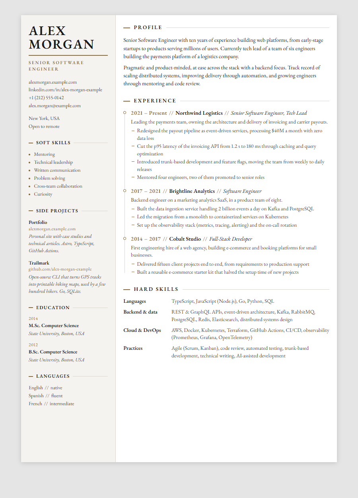
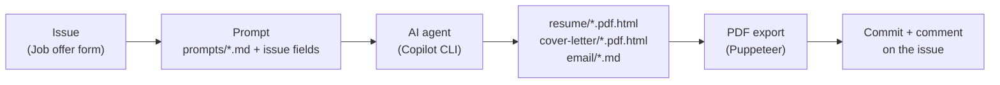

# Appipeline

%22%3E%3Crect x%3D%220%22 y%3D%228%22 width%3D%2228%22 height%3D%2232%22 rx%3D%226%22 fill%3D%22%231e293b%22 stroke%3D%22%233b82f6%22 stroke-width%3D%222%22%2F%3E%3Ctext x%3D%2214%22 y%3D%2228%22 fill%3D%22%2394a3b8%22 font-family%3D%22monospace%22 font-size%3D%2211%22 font-weight%3D%22bold%22 text-anchor%3D%22middle%22%3EJD%3C%2Ftext%3E%3Cline x1%3D%2228%22 y1%3D%2224%22 x2%3D%2256%22 y2%3D%2224%22 stroke%3D%22url(%23appGrad)%22 stroke-width%3D%223%22 stroke-dasharray%3D%224 2%22%2F%3E%3Ccircle cx%3D%2270%22 cy%3D%2224%22 r%3D%2214%22 fill%3D%22%231e293b%22 stroke%3D%22%2306b6d4%22 stroke-width%3D%222%22%2F%3E%3Cpath d%3D%22M64 24 L68 28 L76 19%22 fill%3D%22none%22 stroke%3D%22%2306b6d4%22 stroke-width%3D%222%22 stroke-linecap%3D%22round%22 stroke-linejoin%3D%22round%22%2F%3E%3Cline x1%3D%2284%22 y1%3D%2224%22 x2%3D%22112%22 y2%3D%2224%22 stroke%3D%22url(%23appGrad)%22 stroke-width%3D%223%22%2F%3E%3Crect x%3D%22112%22 y%3D%228%22 width%3D%2226%22 height%3D%2232%22 rx%3D%224%22 fill%3D%22%231e293b%22 stroke%3D%22%233b82f6%22 stroke-width%3D%222%22%2F%3E%3Cline x1%3D%22117%22 y1%3D%2216%22 x2%3D%22133%22 y2%3D%2216%22 stroke%3D%22%233b82f6%22 stroke-width%3D%222%22 stroke-linecap%3D%22round%22%2F%3E%3Cline x1%3D%22117%22 y1%3D%2222%22 x2%3D%22128%22 y2%3D%2222%22 stroke%3D%22%2364748b%22 stroke-width%3D%222%22 stroke-linecap%3D%22round%22%2F%3E%3Cline x1%3D%22117%22 y1%3D%2228%22 x2%3D%22125%22 y2%3D%2228%22 stroke%3D%22%2364748b%22 stroke-width%3D%222%22 stroke-linecap%3D%22round%22%2F%3E%3C%2Fg%3E%3Ctext x%3D%22205%22 y%3D%2257%22 fill%3D%22%23ffffff%22 font-family%3D%22-apple-system%2CBlinkMacSystemFont%2C'Segoe UI'%2CRoboto%2Csans-serif%22 font-size%3D%2226%22 font-weight%3D%22700%22 letter-spacing%3D%22-0.5%22%3EAppipeline%3C%2Ftext%3E%3Ctext x%3D%22207%22 y%3D%2279%22 fill%3D%22%2394a3b8%22 font-family%3D%22-apple-system%2CBlinkMacSystemFont%2C'Segoe UI'%2CRoboto%2Csans-serif%22 font-size%3D%2211%22 font-weight%3D%22500%22 letter-spacing%3D%220.2%22%3ELLM-Driven Career Document Engine%3C%2Ftext%3E%3C%2Fsvg%3E)

**Turn a job offer into a tailored resume, cover letter and application email, right from a GitHub issue.**

[](https://github.com/teddygandon/appipeline/actions/workflows/ci.yml)
[](LICENSE)

Paste a job offer into an issue, and Appipeline has an AI coding agent tailor your resume to it,
write a matching cover letter and draft the application email. The documents are committed to
your repository as print-ready, one-page A4 PDFs, and linked back on the issue.

<p align="center">
  
</p>

## Features

- **A resume template made for tailoring.** A clean, one-page A4 resume in plain HTML and CSS,
  with an embedded guide that tells the AI which blocks it may rewrite and which facts it must
  never change.
- **Three documents per job offer.** A tailored resume, a cover letter that matches its look, and
  a short application email.
- **Written to get through the filters.** The prompts reuse the vocabulary of the job offer for
  applicant tracking systems (ATS), and steer the writing away from the tells of AI-generated text.
- **Pixel-perfect PDFs.** A headless Chrome export with self-hosted fonts, which warns (or fails)
  when a document spills over one page.
- **Fully automated, or fully local.** Run it from a GitHub issue with GitHub Copilot CLI, or
  locally with any coding agent (Claude Code, Copilot CLI, Codex...).

## How it works



Each label of the issue (`resume`, `cover-letter`, `email`) starts one job of the
[`Job offer` workflow](.github/workflows/job-offer.yml). Each job:

1. fills the prompt template of its document with the issue fields
   ([`scripts/build-prompt.js`](scripts/build-prompt.js)),
2. runs it with [GitHub Copilot CLI](https://docs.github.com/copilot/how-tos/use-copilot-agents/use-copilot-cli),
   which writes one new document,
3. exports it to PDF if needed, commits it, and comments on the issue with the links (and the
   text of the email).

## Getting started

### 1. Create your own copy

[**Fork this repository**](https://github.com/teddygandon/appipeline/fork) to get your own copy,
then enable **Issues** (Settings > General > Features) and **Actions** (the Actions tab) on your
fork, since GitHub turns both off on forks.

> [!IMPORTANT]
> A fork of a public repository is always public, and your resume holds personal data. To keep
> your copy private, create it with
> [**Use this template**](https://github.com/teddygandon/appipeline/generate) and choose
> **Private** instead. You can still pull later updates of Appipeline into it as a remote:
> `git remote add upstream https://github.com/teddygandon/appipeline.git`.

```sh
git clone https://github.com/<you>/<your-repository>.git
cd <your-repository>
npm install   # also downloads the headless Chrome used for the PDF export
```

Node.js 20 or later is required.

### 2. Make the resume yours

Replace the content of [`resume/template.pdf.html`](resume/template.pdf.html) with your own
resume. Keep its markup (ids, classes and `data-*` attributes): the tailoring guide at the top
of the file relies on it. Open the file in a browser to preview it, then check it fits on one page:

```sh
npm run export-pdf   # resume/template.pdf.html -> resume/template.pdf
```

### 3. Set up the GitHub automation

1. Create the labels used by the issue form:

   ```sh
   gh label create resume --description "Generate a tailored resume"
   gh label create cover-letter --description "Generate a cover letter"
   gh label create email --description "Generate an application email"
   ```

2. Add a `COPILOT_GITHUB_TOKEN` repository secret: a
   [fine-grained personal access token](https://github.com/settings/personal-access-tokens/new)
   with the **Copilot Requests** permission, from an account with a GitHub Copilot plan.
3. Optionally, add the repository variables below.

| Name                   | Kind     | Description                                                                         |
| ---------------------- | -------- | ----------------------------------------------------------------------------------- |
| `COPILOT_GITHUB_TOKEN` | Secret   | **Required.** Token Copilot CLI runs with.                                          |
| `PORTFOLIO_SITEMAP`    | Variable | URL of your portfolio sitemap: the cover letter and the email link relevant pages.  |
| `COPILOT_MODEL`        | Variable | Model used by Copilot CLI (see `copilot --help`). Defaults to the Copilot CLI default. |

### 4. Apply to a job

Open an issue with the **Job offer** form, fill in the company, the job title and the job
description, and remove the labels of the documents you do not need. A few minutes later, the
documents are committed and linked on the issue.

Labels added after the issue is opened do not start the workflow: run it from the **Actions** tab
(**Job offer** > **Run workflow**) with the issue number, which generates the documents of all its
labels again.

## Using it locally

The prompt templates in [`prompts/`](prompts) work with any coding agent run from the repository
root. Build a ready-to-use prompt from a file holding the issue fields:

```sh
cat > offer.md <<'EOF'
### Company
Acme
### Job title
Senior Backend Engineer
### Job description
(paste the job offer here)
EOF

npm run --silent build-prompt -- resume < offer.md > prompt.txt         # or cover-letter, email
PORTFOLIO_SITEMAP=https://example.com/sitemap.xml npm run --silent build-prompt -- email < offer.md
```

Then hand `prompt.txt` to your agent, for example `claude "$(cat prompt.txt)"`. You can also copy
a template from `prompts/` and replace its `[PLACEHOLDERS]` by hand.

## Exporting to PDF

```sh
npm run export-pdf                                   # resume/template.pdf.html -> resume/template.pdf
npm run export-pdf -- acme-backend-engineer          # a resume of resume/, by name
npm run export-pdf -- cover-letter/acme.pdf.html     # any *.pdf.html page
npm run export-pdf -- --strict cover-letter/acme.pdf.html   # fail if it spills over one page
```

[`scripts/export-pdf.js`](scripts/export-pdf.js) renders the page with
[Puppeteer](https://pptr.dev)'s headless Chrome, downloaded by `npm install`, so no local browser
is needed. It waits for the fonts to load, uses the page's own `@page` rule (A4, no margin), writes
the PDF next to its source and reports the page count.

## The resume template

[`resume/template.pdf.html`](resume/template.pdf.html) is a single self-contained HTML page: no
build step, no framework. Its opening comment is a **tailoring guide** for the AI (or a human):

- blocks marked `data-tailorable="true"` (profile, experience, skills, side projects) may be
  reworded, reordered and trimmed to fit the job offer;
- blocks marked `data-tailorable="false"` (identity, education, languages) and every fact (employers,
  roles, dates, diplomas) must not change, and nothing may be invented;
- the resume must stay on one A4 page.

The sample content describes a fictional candidate, Alex Morgan.

## Project structure

```text
.github/
  ISSUE_TEMPLATE/job-offer.yml   Job offer issue form
  workflows/job-offer.yml        Generates the documents of a job offer
  workflows/ci.yml               Tests, spelling and PDF export check
prompts/                         Prompt templates: resume, cover letter, email
resume/
  template.pdf.html              The master resume
  fonts/                         EB Garamond, self-hosted
scripts/
  build-prompt.js                Fills a prompt template with the fields of an issue
  export-pdf.js                  Exports a *.pdf.html page to PDF
test/                            Unit tests (node --test)
```

Generated documents land in `resume/`, `cover-letter/` and `email/`.

## Development

```sh
npm test                # unit tests
npm run test:spelling   # spelling of the documents, prompts and code (cspell)
```

See [CONTRIBUTING.md](CONTRIBUTING.md) to propose a change.

## Security

The `Job offer` workflow runs an AI agent with all its tools allowed, on text pasted from a job
offer. It only runs for the repository owner. Read [SECURITY.md](SECURITY.md) before changing who
can trigger it.

## Responsible use

Appipeline helps you present your real experience in the words of each job offer. Review every
generated document before sending it: you are responsible for what you submit. The prompts forbid
inventing experience, skills or figures, but an AI can still make mistakes.

## License

[MIT](LICENSE). The [EB Garamond](https://github.com/octaviopardo/EBGaramond12) fonts are
distributed under the [SIL Open Font License 1.1](resume/fonts/OFL.txt).
